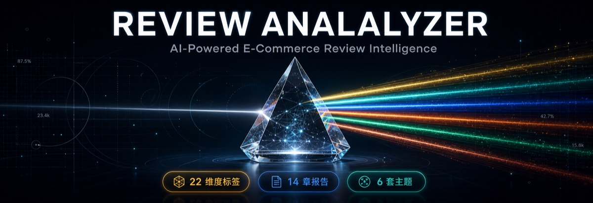

English | [简体中文](README.md)

<div align="center">



# VOC Analyzer

**Turn a pile of product reviews into actionable, decision-ready insight**

[](LICENSE)
[](https://www.python.org/downloads/)

**15-Chapter Deep Insight Report · 6 Themed Visualization Dashboards · Feishu Document Sync · Agent-Native Architecture**

**Created By RicePiggy**

</div>

---

## Project Overview

voc-analyzer is an e-commerce review deep analysis skill developed by RicePiggy for VOC (Voice of Customer) analysis. It turns a batch of product reviews into two outputs: a 22-dimension AI tagging dataset and a 15-chapter insight report. Negative reviews locate product optimization opportunities; positive reviews surface repeatable selling points.

As an Agent-native tool, it works with mainstream AI Coding Agents such as Claude Code, Codex, Cursor, and OpenCode, supports local CSV import and optional SellerSprite integration. The pipeline requires no API key — LLM steps consume the host Agent's quota.

> **V2.2 Agent Self-Execution Mode**: review tagging and report writing are performed by the host Agent itself (`--llm agent`), with no local claude CLI installation required. Without a host Agent, switch to the `--llm cli` direct mode.

### Workflow

```
Data input: local CSV (primary) or SellerSprite (optional)
     ↓
Phase 1: AI deep tagging (concurrency 4, 22-dimension tags)
Phase 2: User persona identification (3-4 personas, 3 positive + 3 negative representative reviews each)
Phase 3: Insight report generation (15-chapter structured report)
Phase 4: Unified output (MD + HTML dashboard + Feishu sync)
```

Python handles the deterministic steps (data loading, batching, statistics, anomaly detection, output packaging). LLM steps are performed by the host Agent, or by the `--llm cli` fallback mode through a local claude/opencode CLI.

---

## Core Features

### 22-Dimension Smart Tags

22 tags across 8 dimensions:

```
Demographic (4): Gender, Age Group, Occupation, Purchase Role
Scenario (1): Usage Scenario
Functional (2): Satisfaction, Specific Features
Quality (3): Material, Craftsmanship, Durability
Service (5): Shipping Speed, Packaging Quality, Customer Service Response, Returns & Exchanges, Warranty
Experience (4): Comfort, Ease of Use, Exterior Design, Price Perception
Market (2): Competitive Comparison, Repurchase Intent
Sentiment (1): Overall Evaluation
```

### 6 Themed Visualization Dashboards

HTML reports ready for work presentations. The shared base architecture keeps content structure identical across all 6 themes:

| Theme | Style | Best For |
|-------|-------|----------|
| premium-gold | Black & Gold Luxury + Playfair Display | Executive presentations, brand showcases |
| dark-tech | Cyberpunk + Cyan + Frosted Glass | Technical teams, data-driven |
| linear-minimal | Minimalist White & Blue + Clear Glass | Product reviews, clean presentations |
| posthog-analytics | Warm White & Orange + Warm Glass | Data analysis, operational reviews |
| stripe-executive | Emerald Green + Emerald Glass | Finance & enterprise, investment decisions |
| warm-editorial | Paper & Copper + Paper Glass | Brand reports, editorial style |

Each dashboard contains 11 sections plus an anomaly signal card area, with Chart.js charts themed to match. Use `--template none` to skip dashboard generation.

### 15-Chapter Deep Insight Report

1. Insight Overview
2. Key Data Overview
3. Core User Personas
4. Key Selling Points & Value Validation
5. Major Pain Points & Negative Attribution
6. Improvement Suggestions & Priorities
7. Potential Opportunities & Differentiation
8. Typical User Deep Analysis
9. Review Time Trend Analysis
10. Rating-Sentiment Divergence
11. Keyword & Topic Clustering
12. Purchase Motivation Attribution Chain
13. Anomaly Signal Cards (severity-graded decision cards)
14. Action Dashboard
15. Data Appendix

### Multi-Format Output and Feishu Sync

| Output | Format | Description |
|--------|--------|-------------|
| Tagging data | CSV | Raw reviews + 22-dimension tags |
| Insight report | Markdown | 15-chapter deep analysis |
| Visualization dashboard | HTML | 6 themes available |
| Feishu document | — | Auto-synced report + mermaid whiteboard |

---

## System Requirements

| Requirement | Details |
|-------------|---------|
| **Operating System** | macOS / Linux / Windows |
| **Python** | 3.10 or higher (3.11.x recommended) |
| **Agent CLI** | Any AI Coding Agent (Claude Code, Codex, Cursor, OpenCode, etc.). Agent self-execution mode needs no extra CLI; headless direct mode requires a local claude or opencode CLI |
| **Memory** | 4GB+ recommended |
| **Feishu Sync (optional)** | Requires [lark-cli](https://github.com/germalli/lark-cli) installed and authenticated |

> **Feishu Sync Note**: to sync results to Feishu documents, install `lark-cli` in advance (`npm install -g lark-cli`) and complete `lark-cli login`. Without it, the tool skips Feishu sync automatically and all other features work as usual.

---

## Quick Start

### Option 1: Install via the skills.sh ecosystem (recommended)

```bash
npx skills add RicePiggy7/voc-analyzer
```

After installation, invoke directly with natural language in Claude Code:

```bash
# Example 1: analyze a specific file
Please analyze the reviews for this product: reviews.csv

# Example 2: describe your need
Help me do a deep analysis of competitor reviews
```

### Option 2: Manually clone the repository

```bash
git clone https://github.com/RicePiggy7/voc-analyzer.git
cd voc-analyzer
pip install -r requirements.txt
```

### Run Parameters

```bash
# === Data input ===

# Option 1: local CSV file
python3 main.py your_reviews.csv --max-reviews 200

# Option 2: SellerSprite data (optional, requires SELLERSPRITE_SECRET_KEY)
python3 main.py --source sellersprite --asin B09XYZ123 --site US --max-reviews 200

# === LLM execution mode (V2.2) ===
# agent (recommended, host Agent self-executes tagging and report):
python3 main.py your_reviews.csv --llm agent --max-reviews 200 --creator "Your Name"
#   → after prepare exits, the host Agent tags/writes per the prompts, advancing with --resume <workdir>
# cli (default, headless fallback, one subprocess call to claude/opencode):
python3 main.py your_reviews.csv --max-reviews 200 --creator "Your Name"

# === Full parameters ===
python3 main.py your_reviews.csv \
  --asin B09XYZ123 \
  --template premium-gold \
  --feishu-sync \
  --concurrent 4 \
  --creator "Your Name"

# === Visualization template (choose 1 of 6, or none to skip) ===
--template premium-gold|dark-tech|linear-minimal|posthog-analytics|stripe-executive|warm-editorial|none

# === Feishu sync (requires lark-cli installed and authenticated) ===
--feishu-sync auto|manual|skip
```

---

## CSV File Format

Column names are fuzzy-matched automatically. A CSV file needs:

| Required Column | Accepted Names (fuzzy match) |
|-----------------|------------------------------|
| Review body | 内容/评价/body/review/text/comment |
| Rating | 打分/rating/score/star |
| Date (optional) | 时间/date/日期/time |

See `examples/reviews_sample.csv` for a sample file.

---

## Output Example

After a run, the following files are generated in the `output/` directory:

### 1. CSV Tag Data

```csv
评论内容,评分,性别,年龄段,职业,购买角色,使用场景,满意度...
"The quality is amazing",5,女性,25-34岁,白领,自用,家用办公,高...
```

### 2. Markdown Insight Report

```markdown
# Product Insight Report

## Key Findings
- User satisfaction: 92%
- Main strengths: solid materials, good design
- Improvement suggestions: better packaging, improved durability
...
```

### 3. HTML Visualization Dashboard

- 6 themes available, see "6 Themed Visualization Dashboards"
- Interactive Chart.js charts built from tagging statistics
- Customizable report signature (`--creator`)

---

## Use Cases

- **Product optimization**: analyze your own product reviews to locate pain points and improve features and design.
- **Competitive analysis**: analyze competitor reviews to understand their strengths and weaknesses and find differentiation opportunities.
- **Market research**: analyze reviews across multiple products to understand market demand and user preferences.
- **User insight**: build user personas from reviews to support marketing decisions.

---

## Project Structure

```
voc-analyzer/
├── main.py                      # V2.0 main entry (4-phase pipeline)
├── SKILL.md                     # Agent instruction file (Claude Code Skill)
├── requirements.txt             # Python dependencies
├── .env.example                 # Environment variable template
├── src/
│   ├── config.py                # Configuration
│   ├── template_engine.py       # Unified template engine (Jinja2 SSR + shared base)
│   ├── chart_engine.py          # Chart.js chart config generator
│   ├── insights_generator.py    # 15-chapter report generation (CLI subprocess)
│   ├── agent_pipeline.py        # Agent self-execution mode (prepare/resume state machine)
│   ├── pipeline_common.py       # Shared output phase (tagged CSV + MD + HTML + Feishu)
│   ├── output_manager.py        # Output management (MD + HTML + Feishu sync)
│   ├── feishu_sync.py           # Feishu document + whiteboard sync
│   ├── report_generator.py      # Report generation (compatibility layer)
│   ├── data_fetchers/           # Data access layer (CSV + SellerSprite)
│   ├── prompts/                 # 15-chapter prompt system
│   └── templates/               # Dashboard templates
│       ├── base/                # Shared base
│       ├── premium-gold/        # Black & gold theme
│       ├── dark-tech/           # Cyberpunk theme
│       ├── linear-minimal/      # Minimalist blue & white theme
│       ├── posthog-analytics/   # Warm orange analytics theme
│       ├── stripe-executive/    # Emerald executive theme
│       └── warm-editorial/      # Paper editorial theme
├── assets/                      # Static assets (README banner)
├── examples/                    # Sample data + output samples
├── tools/                       # Utility scripts
├── references/                  # Reference docs
└── docs/                        # User docs
```

---

## FAQ

<details>
<summary><b>Q1: What API key is required?</b></summary>

**A**: None. In `--llm agent` mode, LLM steps are performed by the host Agent (any AI Coding Agent works, consuming its quota); the `--llm cli` fallback mode uses a Claude Code or OpenCode CLI and consumes that quota instead.
</details>

<details>
<summary><b>Q2: Which e-commerce platforms are supported?</b></summary>

**A**: Any platform that can export reviews as CSV: Amazon, eBay, AliExpress, Shopee, Taobao/Tmall, and other CSV-format review data.
</details>

---

## Capabilities and Limits

**Capabilities:**

- Agent-native: works with mainstream Coding Agents, LLM steps self-executed, no separate CLI installation needed
- Local processing: review data never goes through third-party online services
- Feishu integration: reports and mermaid diagrams sync automatically as Feishu documents and whiteboards
- Template extension: shared base architecture — a new theme needs only one CSS file

**Limits:**

- Requires a Python 3.10+ environment and basic command-line experience
- Review data must be provided by you: platform CSV export, or the SellerSprite API (secret key required)
- Tagging and writing consume host Agent or CLI quota; larger review sets take proportionally longer
- Output is local files (CSV/Markdown/HTML); no online hosting or team collaboration features

---

## Roadmap

- [x] **v1.0.0** - First official release (22-dimension tags + dual mode + HTML dashboard)
- [x] **v2.0.0** - Agent-native version (14-chapter report + 6 themes + Feishu sync + shared base architecture)
- [x] **v2.1.0** - Anomaly signal cards + SellerSprite data source + test suite (52 tests)
- [x] **v2.2.0** - Agent self-execution mode (tagging and report writing by the host Agent, zero CLI dependency; 59 tests)
- [x] **v2.2.1** - Docs and installation metadata revision
- [ ] **v2.3.0** - Web enhancements (frontend template selector + screenshot export)
- [ ] **v3.0.0** - Multi-platform analysis (batch ASIN + competitor comparison reports)

---

## License

This project is licensed under the [MIT License](LICENSE).

---

## Acknowledgments

- Thanks to Anthropic for Claude AI
- Thanks to the open-source community for its projects and practices

---

## Support

- **Issues**: [GitHub Issues](https://github.com/RicePiggy7/voc-analyzer/issues)
- If this tool helps you, a Star is appreciated.
