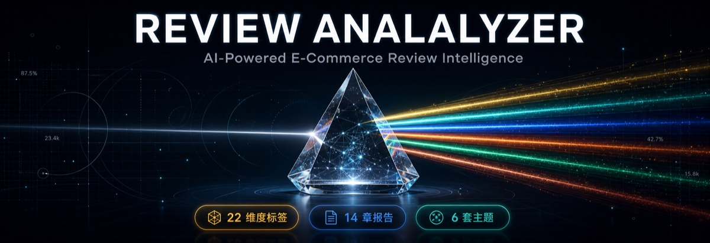

[English](README.en.md) | 简体中文

<div align="center">



# VOC Analyzer

**把一堆产品评论，变成一份能落地的决策依据**

[](LICENSE)
[](https://www.python.org/downloads/)

**15 章深度洞察报告 · 6 套主题可视化看板 · 飞书文档同步 · Agent 原生架构**

**Created By RicePiggy**

</div>

---

## 项目简介

voc-analyzer 是 RicePiggy 研发的电商评论深度分析 Skill，用于 VOC（Voice of Customer，客户之声）分析。它把一批产品评论处理成两类结果：22 维 AI 打标数据和一份 15 章洞察报告。差评用来定位产品优化机会，好评用来总结可复制的卖点。

作为 Agent 原生工具，它适配 Claude Code、Codex、Cursor、OpenCode 等主流 AI Coding Agent，支持本地 CSV 导入和卖家精灵数据对接（可选）。流程不需要 API Key，LLM 工序消耗宿主 Agent 的配额。

> **V2.2 Agent 自执行模式**：评论打标和报告撰写由宿主 Agent 自己完成（`--llm agent`），不依赖本机安装 claude CLI。没有宿主 Agent 时，可改用 `--llm cli` 直跑模式。

### 工作流程

```
数据输入: 本地 CSV（主源）或 卖家精灵（可选）
     ↓
Phase 1: AI 深度打标（并发 4，22 维标签）
Phase 2: 用户画像识别（3-4 个画像，各配 3 正 + 3 负代表性评论）
Phase 3: 洞察报告生成（15 章结构化报告）
Phase 4: 统一输出（MD + HTML 看板 + 飞书同步）
```

Python 负责确定性工序（数据加载、分批、统计、异常检测、输出打包），LLM 工序由宿主 Agent 自行完成，或由 `--llm cli` 后备模式调用本机 claude/opencode CLI 完成。

---

## 核心特性

### 22 维智能标签

覆盖 8 大维度、共 22 个标签：

```
人群维度 (4): 性别、年龄段、职业、购买角色
场景维度 (1): 使用场景
功能维度 (2): 满意度、具体功能
质量维度 (3): 材质、做工、耐用性
服务维度 (5): 发货速度、包装质量、客服响应、退换货、保修
体验维度 (4): 舒适度、易用性、外观设计、价格感知
市场维度 (2): 竞品对比、复购意愿
情感维度 (1): 总体评价
```

### 6 套主题可视化看板

可直接用于工作汇报的 HTML 报告。共享基座架构保证 6 套主题的内容结构一致：

| 主题 | 风格 | 适用场景 |
|------|------|----------|
| premium-gold | 黑金奢华 + Playfair Display | 高管汇报、品牌展示 |
| dark-tech | 赛博朋克 + Cyan + 毛玻璃 | 技术团队、数据驱动 |
| linear-minimal | 极简白蓝 + 清透玻璃 | 产品评审、简洁汇报 |
| posthog-analytics | 暖白橙色 + 暖色玻璃 | 数据分析、运营复盘 |
| stripe-executive | 翡翠绿 + 翡翠玻璃 | 金融企业、投资决策 |
| warm-editorial | 纸色铜色 + 纸感玻璃 | 品牌报告、编辑风格 |

每个看板包含 11 个板块和异常信号卡区，图表基于 Chart.js，配色跟随主题。不需要看板时，用 `--template none` 跳过生成。

### 15 章深度洞察报告

1. 洞察总览
2. 关键数据概览
3. 核心用户画像
4. 核心卖点与价值验证
5. 主要痛点与负面归因
6. 改进建议与优先级
7. 潜在机会与差异化
8. 典型用户深度解析
9. 评论时间趋势分析
10. 评分与文本情感背离
11. 关键词与话题聚类
12. 购买动机归因链
13. 异常信号卡（严重度分级决策卡）
14. 行动决策仪表盘
15. 数据附录

### 多格式输出与飞书同步

| 输出 | 格式 | 说明 |
|------|------|------|
| 打标数据 | CSV | 原始评论 + 22 维标签 |
| 洞察报告 | Markdown | 15 章深度分析 |
| 可视化看板 | HTML | 6 套主题可选 |
| 飞书文档 | — | 自动同步报告 + mermaid 白板 |

---

## 系统要求

| 要求 | 详情 |
|------|------|
| **操作系统** | macOS / Linux / Windows |
| **Python** | 3.10 或更高版本（推荐 3.11.x） |
| **Agent CLI** | 任一 AI Coding Agent（Claude Code、Codex、Cursor、OpenCode 等）。Agent 自执行模式无需额外 CLI；headless 直跑模式需要本机装有 claude 或 opencode |
| **内存** | 建议 4GB+ |
| **飞书同步（可选）** | 需安装 [lark-cli](https://github.com/germalli/lark-cli) 并完成认证登录 |

> **飞书同步说明**：如需将分析结果同步到飞书文档，需提前安装 `lark-cli`（`npm install -g lark-cli`）并完成 `lark-cli login` 认证。未安装时工具会自动跳过飞书同步，不影响其他功能。

---

## 快速开始

### 方式 1：使用 skills.sh 生态安装（推荐）

```bash
npx skills add RicePiggy7/voc-analyzer
```

安装后，在 Claude Code 中直接用自然语言调用：

```bash
# 示例 1：指定文件分析
请分析这个产品的评论：reviews.csv

# 示例 2：描述需求
帮我做一下竞品评论的深度分析
```

### 方式 2：手动克隆仓库

```bash
git clone https://github.com/RicePiggy7/voc-analyzer.git
cd voc-analyzer
pip install -r requirements.txt
```

### 运行参数

```bash
# === 数据输入方式 ===

# 方式 1：本地 CSV 文件
python3 main.py your_reviews.csv --max-reviews 200

# 方式 2：卖家精灵数据（可选，需配置 SELLERSPRITE_SECRET_KEY）
python3 main.py --source sellersprite --asin B09XYZ123 --site US --max-reviews 200

# === LLM 执行模式（V2.2） ===
# agent（推荐，宿主 Agent 自执行打标与报告）:
python3 main.py your_reviews.csv --llm agent --max-reviews 200 --creator "Your Name"
#   → prepare 退出后，宿主 Agent 按 prompt 打标/撰写报告，用 --resume <workdir> 推进
# cli（默认，headless 后备，subprocess 调 claude/opencode 一次跑完）:
python3 main.py your_reviews.csv --max-reviews 200 --creator "Your Name"

# === 完整参数 ===
python3 main.py your_reviews.csv \
  --asin B09XYZ123 \
  --template premium-gold \
  --feishu-sync \
  --concurrent 4 \
  --creator "Your Name"

# === 可视化模板（6 选 1，或 none 跳过） ===
--template premium-gold|dark-tech|linear-minimal|posthog-analytics|stripe-executive|warm-editorial|none

# === 飞书同步（需提前安装 lark-cli 并认证） ===
--feishu-sync auto|manual|skip
```

---

## CSV 文件格式要求

工具支持自动模糊匹配列名，CSV 文件需包含：

| 必需列 | 可选列名（模糊匹配） |
|--------|---------------------|
| 评论内容 | 内容/评价/body/review/text/comment |
| 评分 | 打分/rating/score/star |
| 时间（可选） | 时间/date/日期/time |

示例文件见 `examples/reviews_sample.csv`。

---

## 输出示例

运行完成后，在 `output/` 目录生成以下文件：

### 1. CSV 标签数据

```csv
评论内容,评分,性别,年龄段,职业,购买角色,使用场景,满意度...
"The quality is amazing",5,女性,25-34岁,白领,自用,家用办公,高...
```

### 2. Markdown 洞察报告

```markdown
# 产品分析洞察报告

## 核心发现
- 用户满意度：92%
- 主要优势：材质优良、设计美观
- 改进建议：优化包装、增强耐用性
...
```

### 3. HTML 可视化看板

- 6 套主题可选，见「6 套主题可视化看板」
- 交互式 Chart.js 图表，数据来自打标结果统计
- 报告署名可自定义（`--creator` 参数）

---

## 使用场景

- **产品优化**：分析自己产品的评论，定位用户痛点，改进功能和设计。
- **竞品分析**：分析竞品评论，了解对手的优势与短板，寻找差异化机会。
- **市场调研**：批量分析多个产品的评论，了解市场需求和用户偏好。
- **用户洞察**：从评论中构建用户画像，为营销策略提供依据。

---

## 项目结构

```
voc-analyzer/
├── main.py                      # V2.0 主入口（4 Phase 流程）
├── SKILL.md                     # Agent 指令文件（Claude Code Skill）
├── requirements.txt             # Python 依赖
├── .env.example                 # 环境变量模板
├── src/
│   ├── config.py                # 配置
│   ├── template_engine.py       # 统一模板引擎（Jinja2 SSR + 共享基座）
│   ├── chart_engine.py          # Chart.js 图表配置生成
│   ├── insights_generator.py    # 15 章洞察报告生成（CLI subprocess）
│   ├── agent_pipeline.py        # Agent 自执行模式（prepare/resume 状态机）
│   ├── pipeline_common.py       # 共享输出阶段（打标 CSV + MD + HTML + 飞书）
│   ├── output_manager.py        # 输出管理（MD + HTML + 飞书同步）
│   ├── feishu_sync.py           # 飞书文档 + 白板同步
│   ├── report_generator.py      # 报告生成（兼容层）
│   ├── data_fetchers/           # 数据接入层（CSV + 卖家精灵）
│   ├── prompts/                 # 15 章 Prompt 体系
│   └── templates/               # 可视化看板模板
│       ├── base/                # 共享基座
│       ├── premium-gold/        # 黑金主题
│       ├── dark-tech/           # 赛博朋克主题
│       ├── linear-minimal/      # 极简蓝白主题
│       ├── posthog-analytics/   # 暖橙分析主题
│       ├── stripe-executive/    # 翡翠企业主题
│       └── warm-editorial/      # 报纸编辑主题
├── assets/                      # 静态资源（README banner）
├── examples/                    # 示例数据 + 输出样例
├── tools/                       # 工具脚本
├── references/                  # 参考文档
└── docs/                        # 用户文档
```

---

## 常见问题

<details>
<summary><b>Q1: 需要什么 API Key？</b></summary>

**A**: 不需要。`--llm agent` 模式下 LLM 工序由宿主 Agent 自执行（任何 AI Coding Agent 均可，消耗宿主配额）；`--llm cli` 后备模式使用 Claude Code 或 OpenCode CLI，消耗对应配额。
</details>

<details>
<summary><b>Q2: 支持哪些电商平台？</b></summary>

**A**: 支持所有可以导出评论 CSV 的平台：Amazon、eBay、AliExpress、Shopee、淘宝/天猫，以及其他 CSV 格式的评论数据。
</details>

---

## 能力与边界

**能力：**

- Agent 原生：适配主流 AI Coding Agent，LLM 工序自执行，无需单独安装 CLI
- 本地处理：评论数据不经过第三方在线服务
- 飞书集成：报告与 mermaid 图表可自动同步为飞书文档和白板
- 模板扩展：共享基座架构，新增一套主题只需要一个 CSS 文件

**边界：**

- 需要 Python 3.10+ 环境和基本的命令行使用经验
- 评论数据需要自备：平台 CSV 导出，或卖家精灵 API（需 secret key）
- 打标和撰写消耗宿主 Agent 或 CLI 的配额，评论量越大耗时越长
- 输出为本地文件（CSV/Markdown/HTML），不提供在线托管和团队协作功能

---

## 路线图

- [x] **v1.0.0** - 首个正式发布（22 维标签 + 双模式 + HTML 看板）
- [x] **v2.0.0** - Agent 原生版（14 章报告 + 6 套主题 + 飞书同步 + 共享基座架构）
- [x] **v2.1.0** - 异常信号卡 + 卖家精灵数据源 + 测试套件（52 用例）
- [x] **v2.2.0** - Agent 自执行模式（打标与报告由宿主 Agent 完成，零 CLI 依赖；测试 59 用例）
- [x] **v2.2.1** - 文档与安装元数据修订
- [ ] **v2.3.0** - Web 端增强（前端模板选择器 + 截图导出）
- [ ] **v3.0.0** - 多平台分析（批量 ASIN + 竞品对比报告）

---

## 许可证

本项目采用 [MIT License](LICENSE) 开源许可证。

---

## 致谢

- 感谢 Anthropic 提供 Claude AI
- 感谢开源社区的项目与实践带来的启发

---

## 技术支持

- **Issues**: [GitHub Issues](https://github.com/RicePiggy7/voc-analyzer/issues)
- 如果这个工具对你有帮助，欢迎 Star 支持。
